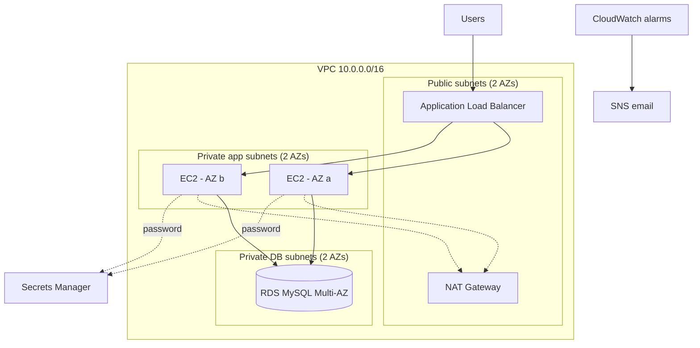

# Highly Available Web Application on AWS

A three-tier web app built entirely with Terraform. Traffic goes through an Application Load Balancer to Linux EC2 instances in an Auto Scaling group, which store data in a Multi-AZ RDS MySQL database. Everything runs across two Availability Zones, so losing one server, or a whole zone, does not take the site down.

## Architecture



| Layer | What it does |
| --- | --- |
| VPC | 6 subnets: 2 public, 2 private app, 2 private database, in two AZs |
| Load balancer | Spreads traffic and runs health checks on `/health` every 15 seconds |
| Auto Scaling | 2 to 4 `t3.micro` instances, scales to hold average CPU near 70% |
| Database | RDS MySQL 8.0, encrypted, Multi-AZ, no public access |
| Security | Security groups chained ALB → app → DB; no SSH port open; DB password in Secrets Manager; IMDSv2 required |
| Monitoring | CloudWatch alarms for high CPU, unhealthy hosts and low DB storage, sent by email through SNS |

## Cost

About **$3 to $4 per day** while running (NAT gateway, load balancer, 2 EC2 instances, RDS). Build it, test it, take screenshots, and run `terraform destroy` the same day. Set `db_multi_az = false` while you are still building.

## Deploy

Prerequisites: an AWS account, the [AWS CLI](https://docs.aws.amazon.com/cli/latest/userguide/getting-started-install.html) configured with `aws configure`, and [Terraform](https://developer.hashicorp.com/terraform/install) 1.5 or newer.

```bash
cd 01-ha-web-app
cp terraform.tfvars.example terraform.tfvars   # put your email in it
terraform init
terraform plan
terraform apply                                # takes about 10-15 minutes (RDS is slow)
```

Confirm the SNS subscription email AWS sends you. When `apply` finishes it prints `app_url`. Wait 3 to 4 minutes for the instances to pass health checks, then open it. Refresh a few times: the instance ID and AZ change as the load balancer switches servers, and the visit count keeps going up because it lives in RDS.

## Test it (and take screenshots)

1. **Load balancing:** refresh the page and capture two different instance IDs.
2. **Self-healing:** in the EC2 console, terminate one instance. The site stays up, the unhealthy-host alarm emails you, and Auto Scaling launches a replacement within a few minutes.
3. **Scaling out:** connect to an instance with Session Manager (EC2 console → Connect → Session Manager) and run a CPU load:
   ```bash
   sudo dnf install -y stress-ng && stress-ng --cpu 2 --timeout 600
   ```
   Watch the Auto Scaling group's Activity tab add an instance.
4. **Database failover** (with `db_multi_az = true`): RDS console → your DB → Actions → Reboot → "Reboot with failover". The app recovers in about a minute.
5. **Security check:** try to reach the DB endpoint from your laptop. It times out, because it has no public access.

Put the screenshots in a `screenshots/` folder and link them here.

## Clean up

```bash
terraform destroy
```

## Things to be ready to explain

- Why the app servers are in private subnets, and how they still reach the internet (NAT gateway).
- Why there is one NAT gateway instead of two (cost), and what breaks if its AZ goes down.
- How the security groups reference each other instead of IP ranges.
- Why the password is in Secrets Manager and how the EC2 role gets access to it.
- The difference between Multi-AZ (high availability) and read replicas (read scaling).
- How target tracking scaling decides when to add an instance.
