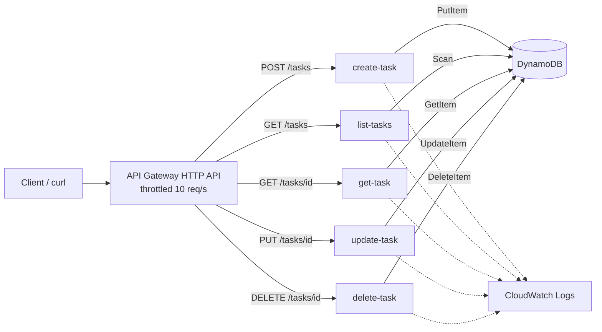

# Serverless Task Tracker API

A REST API for creating, reading, updating and deleting tasks. It runs on API Gateway, five Python Lambda functions and DynamoDB, so there are no servers to manage. The whole stack comes from one CloudFormation template and can be rebuilt in any account or region with one command.

## Architecture



Each function has **its own IAM role** that allows exactly one DynamoDB action on this one table. For example, the list function cannot delete anything even if its code had a bug.

| Endpoint | Function | DynamoDB action | Returns |
| --- | --- | --- | --- |
| `POST /tasks` | create-task | PutItem | 201 + new task |
| `GET /tasks` (optional `?status=done`) | list-tasks | Scan | 200 + list |
| `GET /tasks/{id}` | get-task | GetItem | 200 or 404 |
| `PUT /tasks/{id}` | update-task | UpdateItem | 200 or 404 |
| `DELETE /tasks/{id}` | delete-task | DeleteItem | 204 or 404 |

Other details: input validation (title 1 to 200 characters, status must be `todo`, `in-progress` or `done`), updates never create tasks by accident (a conditional write), DynamoDB encryption and point-in-time recovery, API access logs, 7-day log retention, and a CloudWatch alarm on 5xx errors.

## Cost

Practically free. Lambda, API Gateway and DynamoDB on-demand all fit in the AWS free tier at demo traffic.

## Deploy

```bash
cd 02-serverless-task-api
aws cloudformation deploy \
  --template-file template.yaml \
  --stack-name task-api \
  --capabilities CAPABILITY_IAM

# get the URL
API=$(aws cloudformation describe-stacks --stack-name task-api \
  --query "Stacks[0].Outputs[?OutputKey=='ApiUrl'].OutputValue" --output text)
echo $API
```

## Try it

```bash
# create
curl -s -X POST $API/tasks -H "content-type: application/json" \
  -d '{"title": "Study for SAA-C03"}'

# list everything, or only finished tasks
curl -s $API/tasks
curl -s "$API/tasks?status=done"

# get, update, delete (paste an id from the create response)
curl -s $API/tasks/<id>
curl -s -X PUT $API/tasks/<id> -H "content-type: application/json" -d '{"status": "done"}'
curl -s -X DELETE $API/tasks/<id> -i

# validation errors come back as 400
curl -s -X POST $API/tasks -H "content-type: application/json" -d '{"title": ""}'
```

Screenshots worth taking: the curl output, the DynamoDB table items, one function's IAM role policy, and a CloudWatch log entry.

## Test locally (no AWS account needed)

The tests pull each function's code out of the template and run it against a mock DynamoDB using [moto](https://github.com/getmoto/moto).

```bash
pip install boto3 moto pytest pyyaml cfn-lint
pytest -v
cfn-lint template.yaml
```

## Clean up

```bash
aws cloudformation delete-stack --stack-name task-api
```

## Things to be ready to explain

- Why one role per function (least privilege, smaller blast radius).
- Why `Scan` is fine here but slow at scale, and how a GSI on `status` would replace it.
- What `ConditionExpression="attribute_exists(id)"` prevents.
- HTTP API vs REST API in API Gateway (cost, features).
- Cold starts and how memory size affects Lambda speed and cost.
- How throttling protects the backend and your bill.
