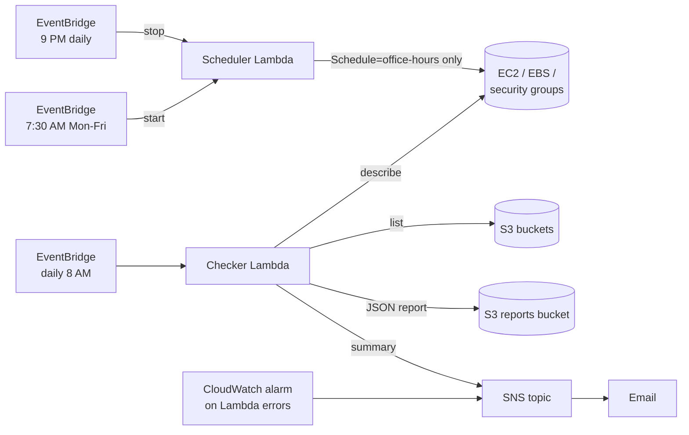

# AWS Security and Cost Checker

Two scheduled Lambda functions, deployed with Terraform, that keep an AWS account safe and cheap:

- **Checker** runs every morning. It looks for risky settings, saves a full JSON report to S3, and emails a summary through SNS.
- **Scheduler** stops development EC2 instances every night and starts them again on weekday mornings, so they don't run (and bill) while nobody is using them.

## Architecture



## What the checker flags

| Check | Why it matters |
| --- | --- |
| Security groups allowing SSH (22) or RDP (3389) from `0.0.0.0/0` or `::/0` | The most common way servers get broken into |
| S3 buckets without full Block Public Access (skipped if the account-level block is on) | Prevents accidental data leaks |
| Unencrypted EBS volumes | Many compliance rules require encryption at rest |
| EC2 instances missing an `Owner` tag | Untagged servers are how surprise bills happen |

## Security design

- The checker's role is **read-only** for inventory, can only write under `reports/` in its own bucket, and can only publish to its own SNS topic.
- The scheduler's role can stop and start **only instances tagged `Schedule=office-hours`**, enforced by an IAM condition (`aws:ResourceTag/Schedule`), not just by the code.
- The reports bucket blocks all public access, is encrypted, and deletes reports after 90 days.

## Cost

Effectively free: a few Lambda runs per day, a few KB in S3, and SNS email. The scheduler saves money: a `t3.medium` stopped 13 hours a day and on weekends runs about 70% fewer hours.

## Deploy

```bash
cd 03-security-cost-checker
cp terraform.tfvars.example terraform.tfvars   # put your email in it
terraform init
terraform apply
```

Confirm the SNS subscription email. Then run the checker once instead of waiting for the morning:

```bash
aws lambda invoke --function-name account-checker-checker out.json && cat out.json
```

## Try it (and take screenshots)

1. **Create a problem on purpose:** make a security group with SSH open to `0.0.0.0/0`, then run the checker. You get an email listing it. Delete the group afterwards.
2. **Read the report:** open the reports bucket in S3 and view the JSON file.
3. **Test the scheduler:** launch a `t3.micro` tagged `Schedule=office-hours`, then run:
   ```bash
   aws lambda invoke --function-name account-checker-scheduler \
     --cli-binary-format raw-in-base64-out --payload '{"action":"stop"}' out.json
   ```
   The instance stops. An untagged instance is left alone.
4. **Show least privilege:** try stopping an untagged instance with the scheduler's role (IAM policy simulator). It is denied.

## Test locally (no AWS account needed)

```bash
pip install boto3 moto pytest
pytest -v
```

## Clean up

```bash
terraform destroy
```

## Things to be ready to explain

- Why `Describe*` permissions need `"*"` but stop/start can be limited by tag.
- How EventBridge cron works and that it runs in UTC (and what happens at daylight saving time).
- Why S3 default encryption is no longer the risk it was (SSE-S3 is on by default since 2023), and why public access still is.
- How you would extend this to every region, or to many accounts using AWS Organizations.
- What AWS services do this at scale (AWS Config, Security Hub, Instance Scheduler) and why building it yourself teaches the basics.
